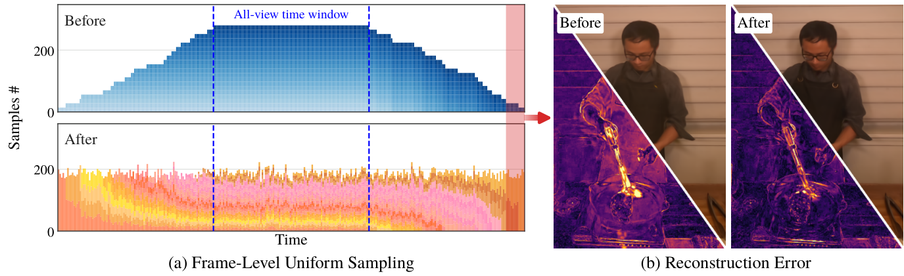

<div align="center">

# DebiasDesync

### Debiasing the View Coverage Bias for Desynchronized Dynamic Scene Reconstruction

**Minwoo Tae**¹ · Jeong-gi Kwak² · Sunoh Kim¹ · Sang-Il Choi¹\* · Kwang Moo Yi²\*

¹ Dankook University, South Korea &nbsp;&nbsp;·&nbsp;&nbsp; ² University of British Columbia, Canada
<br><sub>\* Corresponding authors</sub>



</div>

We propose a simple method to balance the view coverage bias when reconstructing dynamic scenes from multiple desynchronized videos. When multiple videos of the same scene are captured from various views in the wild, they are often desynchronized: some start later, and some end earlier than the rest. In these cases, the amount of coverage a point in space and time has differs from one point to the other, leading to 4D representations focusing on one point over the other, especially prominent in dynamic parts of the scene where observations are limited. We thus propose to debias the training of 4D representations: (1) by sampling uniformly across modeled time, not across captured frames; and (2) by assigning higher weight to pixels with higher reconstruction error during training. We evaluate our method on the Plenoptic Video dataset by introducing random camera-specific time offsets of up to 100 frames, and show that, while simple, it enhances the reconstruction quality, especially in dynamic regions.

This repository provides:

- Our training strategy on two backbones, [4DGaussians](https://github.com/hustvl/4DGaussians) and [Gaussian-Flow](https://github.com/Linyou/D3DGS)
- Scripts that build the desynchronized split of the Plenoptic Video dataset
- Scripts that train, render and evaluate every cell of Table 1

## 🔧 Installation

- One conda environment per backbone; both bundle nvcc 11.7 and gcc 11, so no system CUDA toolkit is needed
- A [COLMAP](https://colmap.github.io/) binary with CUDA is needed once, to build the dataset (`conda create -n colmap -c conda-forge colmap`)
- Tested on Ubuntu with an RTX 3090 (24 GB); Gaussian-Flow needs about that much GPU memory

```bash
git clone https://github.com/minutae1026/DebiasDesync.git && cd DebiasDesync

# 4DGaussians (also runs the evaluation)
conda env create -f backbones/4DGaussians/environment.yml
conda activate debiasdesync && bash backbones/4DGaussians/setup_env.sh

# Gaussian-Flow
conda env create -f backbones/Gaussian-Flow/environment.yml
conda activate debiasdesync-gaussian-flow && bash backbones/Gaussian-Flow/setup_env.sh
```

Layout:

```
{$ROOT}
├── backbones/
│   ├── 4DGaussians/            # hustvl/4DGaussians + our training strategy
│   └── Gaussian-Flow/          # Linyou/D3DGS + our training strategy
├── scripts/
│   ├── data/                   # download → desynchronize → COLMAP → dynamic masks → check
│   ├── train_table1.sh         # 4DGaussians rows of Table 1
│   └── train_table1_gflow.sh   # Gaussian-Flow rows of Table 1
├── data/dynerf/<scene>/        # ← built by scripts/data (not tracked)
└── output/<backbone>/<run>/    # ← training runs (not tracked)
```

## 📥 Dataset

- We use the six scenes of the [Plenoptic Video dataset](https://github.com/facebookresearch/Neural_3D_Video) ([v1.0 release](https://github.com/facebookresearch/Neural_3D_Video/releases/tag/v1.0))
- The desynchronized split is not redistributed; the scripts below download the release and rebuild it

```bash
conda activate debiasdesync
bash scripts/data/fetch_dynerf_src.sh                                     # release → data/_dynerf_src/ (~15 GB)
python scripts/data/unpack_dynerf_src.py
COLMAP_ENV=/path/to/conda/envs/colmap bash scripts/data/build_scenes.sh   # → data/dynerf/<scene>/ (~50 GB)
```

- Every training camera keeps a 200-frame window of the 300-frame timeline, with random starts so that time offsets reach up to 100 frames
- `cam00` keeps all 300 frames and serves as the test view
- `build_scenes.sh` also runs COLMAP for the initial point cloud, computes the dynamic masks of the test view and checks every scene
- The per-camera offsets are shipped in `backbones/4DGaussians/arguments/dynerf/<scene>.py` and verified against the built data

## 🚀 Training

```bash
# 4DGaussians rows
conda activate debiasdesync
RUNS=3 bash scripts/train_table1.sh

# Gaussian-Flow rows
GFLOW_PY=/path/to/envs/debiasdesync-gaussian-flow/bin/python EVAL_PY=/path/to/envs/debiasdesync/bin/python \
RUNS=3 bash scripts/train_table1_gflow.sh
```

- Each queue covers 6 scenes × {baseline, ours} × `RUNS` repetitions (about 80 min per run on an RTX 3090)
- Each run trains, renders the 300 test frames and writes `results.json` / `per_view.json` into `output/<backbone>/<scene>_<condition>_<k>/`
- Completed runs are skipped, so an interrupted queue can be restarted

<details>
<summary><b>Single runs by hand</b></summary>

<br>

4DGaussians (from `backbones/4DGaussians/`, env `debiasdesync`):

```bash
S=sear_steak; M=../../output/4DGaussians/${S}_dynamic_1
python train.py -s ../../data/dynerf/$S --model_path $M --configs arguments/dynerf/$S.py --resolution 2 \
       --uniform_time_sampling --pixel_weighting --pixel_weighting_ratio 30     # drop the three flags for the baseline
python render.py  --model_path $M --skip_train --configs arguments/dynerf/$S.py
python metrics.py --model_path $M --dynamic_mask_root ../../data/dynerf --cleanup
```

Gaussian-Flow (from `backbones/Gaussian-Flow/`, env `debiasdesync-gaussian-flow`; `gf_base.py` = as released, `gf_ours.py` = + ours):

```bash
S=sear_steak; M=../../output/Gaussian-Flow/${S}_ours_1
python train.py -s ../../data/dynerf/$S --model_path $M --config arguments/dynerf/gf_ours.py --test_iterations 29999 --eval
python render_dynamic.py -s ../../data/dynerf/$S --model_path $M --configs arguments/dynerf/gf_ours.py --eval --skip_train --skip_video --ckpt_name chkpnt30000.pth
conda activate debiasdesync && python ../4DGaussians/metrics.py --model_path $M --dynamic_mask_root ../../data/dynerf --cleanup
```

| 4DGaussians option | Default | Description |
| --- | --- | --- |
| `--uniform_time_sampling` | off | Frame-level uniform sampling across time (Sec. 3.1) |
| `--pixel_weighting` | off | Pixel-level weighing of the L1 loss by reconstruction error (Sec. 3.2) |
| `--pixel_weighting_ratio` | `30` | r in λ = log r, the strength of the weighing |
| `--pixel_weighting_warmup` | `1000` | Fine-stage iterations over which the weighing exponent ramps from 0 to 1 |

The same options for Gaussian-Flow live in `backbones/Gaussian-Flow/arguments/dynerf/gf_ours.py`.

</details>

## 📊 Evaluation

- Metrics are computed by `backbones/4DGaussians/metrics.py` for both backbones and written to `results.json` of every run
- **PSNR** (`PSNR`): full image · **DyPSNR** (`Dynamic-PSNR`): dynamic pixels of the test view · **DyPSNR-60** (`Dynamic-PSNR-edge60`): first and last 30 frames, the times with the fewest views
- Each entry below is the mean ± std over three runs

| Method | PSNR ↑ | DyPSNR ↑ | DyPSNR-60 ↑ |
| --- | --- | --- | --- |
| 4DGaussians | 30.92 | 24.71 | 23.22 |
| 4DGaussians + Ours | **31.15** | **25.59** | **24.97** |
| Gaussian-Flow | 30.77 | 23.82 | 21.74 |
| Gaussian-Flow + Ours | **30.87** | **24.73** | **23.31** |

<details>
<summary><b>Per-scene numbers (Table 1)</b></summary>

<br>

| Method | Coffee Martini | | | Cook Spinach | | | Cut Roasted Beef | | |
| --- | --- | --- | --- | --- | --- | --- | --- | --- | --- |
| | PSNR | DyPSNR | DyPSNR-60 | PSNR | DyPSNR | DyPSNR-60 | PSNR | DyPSNR | DyPSNR-60 |
| 4DGaussians | 28.38±0.41 | 22.94±0.21 | 20.47±0.37 | 31.65±0.41 | 24.91±0.04 | 23.30±0.08 | 32.20±0.36 | 27.64±0.04 | 25.81±0.04 |
| 4DGaussians + Ours | 28.65±0.17 | 24.39±0.05 | 22.82±0.13 | 31.79±0.22 | 25.03±0.06 | 23.98±0.05 | 32.14±0.26 | 28.01±0.21 | 27.29±0.17 |
| Gaussian-Flow | 28.56±0.27 | 23.56±0.03 | 19.56±0.04 | 31.48±0.19 | 23.45±0.06 | 21.70±0.12 | 31.76±0.43 | 26.12±0.23 | 23.61±0.11 |
| Gaussian-Flow + Ours | 28.51±0.11 | 24.02±0.07 | 20.06±0.10 | 31.78±0.13 | 24.43±0.01 | 23.39±0.02 | 32.29±0.56 | 27.05±0.21 | 25.18±0.13 |

| Method | Flame Salmon | | | Flame Steak | | | Sear Steak | | |
| --- | --- | --- | --- | --- | --- | --- | --- | --- | --- |
| | PSNR | DyPSNR | DyPSNR-60 | PSNR | DyPSNR | DyPSNR-60 | PSNR | DyPSNR | DyPSNR-60 |
| 4DGaussians | 28.87±0.04 | 19.83±0.04 | 19.35±0.09 | 32.30±0.27 | 24.86±0.12 | 23.66±0.07 | 32.11±0.33 | 28.09±0.20 | 26.73±0.11 |
| 4DGaussians + Ours | 28.97±0.14 | 21.31±0.06 | 21.64±0.04 | 32.73±0.14 | 25.83±0.12 | 25.40±0.21 | 32.59±0.22 | 28.96±0.07 | 28.67±0.09 |
| Gaussian-Flow | 29.09±0.21 | 19.52±0.02 | 17.70±0.06 | 31.63±0.56 | 23.76±0.15 | 22.12±0.10 | 32.10±0.16 | 26.53±0.11 | 25.74±0.08 |
| Gaussian-Flow + Ours | 29.14±0.07 | 20.71±0.05 | 19.27±0.18 | 31.55±0.65 | 24.77±0.26 | 24.33±0.06 | 31.96±0.20 | 27.37±0.11 | 27.63±0.10 |

</details>

## 📖 Citation

```bibtex
@inproceedings{tae2027debiasdesync,
  title     = {Debiasing the View Coverage Bias for Desynchronized Dynamic Scene Reconstruction},
  author    = {Tae, Minwoo and Kwak, Jeong-gi and Kim, Sunoh and Choi, Sang-Il and Yi, Kwang Moo},
  booktitle = {IEEE/CVF Winter Conference on Applications of Computer Vision (WACV)},
  year      = {2027}
}
```

## 🙏 Acknowledgement

This code builds on [4DGaussians](https://github.com/hustvl/4DGaussians), [Gaussian-Flow (D3DGS)](https://github.com/Linyou/D3DGS), the [3D Gaussian Splatting](https://github.com/graphdeco-inria/gaussian-splatting) rasterizer and the [Plenoptic Video dataset](https://github.com/facebookresearch/Neural_3D_Video).
